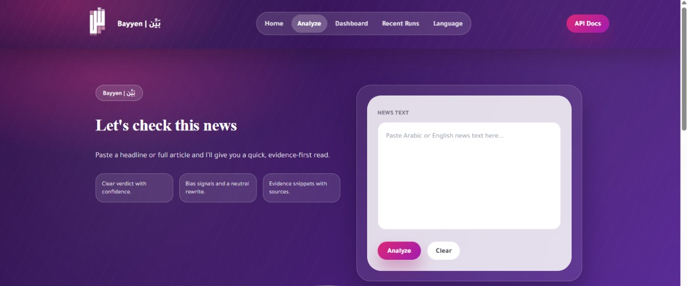
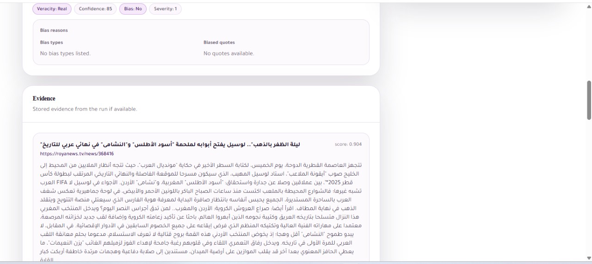
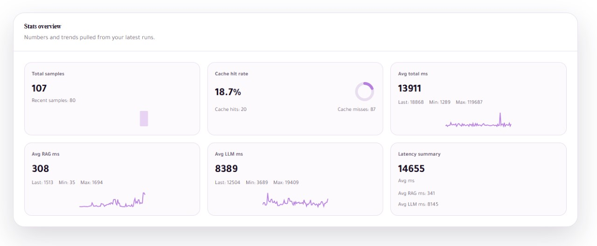
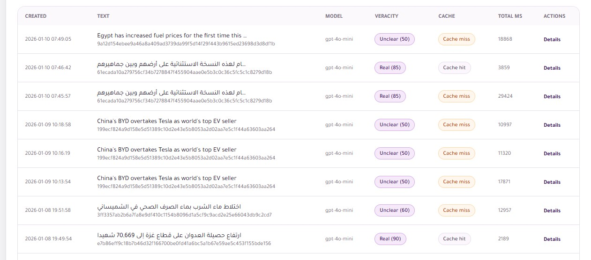
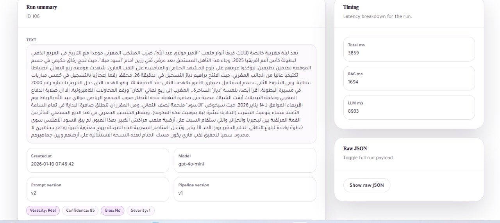

# 📰 Bayyen | بيّن
### AI-Powered News Authenticity Detection & Bias Analysis

An Artificial Intelligence graduation project designed to analyze news content, assess its authenticity, retrieve supporting evidence, and identify potential bias using Natural Language Processing (NLP), Retrieval-Augmented Generation (RAG), and Large Language Models (LLMs).

---

## 🎯 Project Overview

**Bayyen | بيّن** is an AI-powered news verification platform developed to help users evaluate the credibility of news articles.

Users can submit news text in Arabic or English. The system processes the content, retrieves relevant information, and generates an AI-assisted authenticity assessment supported by available evidence.

The platform also provides bias analysis, explanations, neutral rewrites, historical analysis records, and a performance monitoring dashboard.

The project combines a Python backend, FastAPI, RAG-based information retrieval, an LLM-powered analysis pipeline, and a React/TypeScript frontend.

---

## ✨ Key Features

### 📰 News Authenticity Assessment
- Analyze news articles submitted in Arabic or English.
- Classify news authenticity using AI-assisted analysis.
- Display classifications such as Real or Unclear.
- Provide confidence scores and supporting explanations.

### 🔍 Evidence Retrieval & Verification
- Retrieve relevant evidence from available information sources.
- Display source URLs and supporting article excerpts.
- Show relevance scores for retrieved evidence.
- Help users review information supporting the analysis.

### ⚖️ Bias Analysis
- Identify potential bias in news content.
- Display bias indicators and explanations when available.
- Highlight biased quotations when detected.
- Generate neutral rewrites of news text.

### 🤖 Retrieval-Augmented Generation (RAG)
- Combine information retrieval with LLM-based analysis.
- Use relevant retrieved content to support authenticity assessments.
- Integrate semantic search and evidence retrieval into the analysis pipeline.

### 💾 Database Integration & Caching
- Store analysis records for future reference.
- Reuse previously cached results when available.
- Track cache hits and misses.
- Reduce repeated processing for previously analyzed content.

### 📊 Analytics Dashboard
- Monitor total analysis samples.
- Track cache hit rates.
- Display RAG and LLM processing times.
- Visualize performance trends and execution latency.

### 🕘 Analysis History
- Browse previously analyzed news articles.
- Review authenticity classifications and confidence scores.
- Access detailed analysis records.
- Inspect execution metrics and stored evidence.

### 🌐 Interactive Web Application
- Responsive user interface developed using React and TypeScript.
- Support for Arabic and English news text.
- Integration with backend APIs.
- Dedicated pages for analysis, dashboard statistics, and recent runs.

---

## 🛠️ Technology Stack

| Category | Technologies |
|----------|--------------|
| Programming Language | Python |
| Backend Framework | FastAPI |
| Frontend | React, TypeScript |
| Artificial Intelligence | NLP, LLMs, RAG |
| LLM Integration | OpenAI API (GPT-4o-mini) |
| Embeddings | Sentence Transformers |
| Vector Search | FAISS |
| Information Retrieval | Semantic Search, External Search Integration |
| Data Management | Database Integration, Analysis History |
| Performance | Caching, Latency Monitoring |
| API Architecture | REST APIs |

---

## 🔄 How It Works

1. **News Submission:** The user submits news text in Arabic or English.
2. **Cache Lookup:** The system checks whether a reusable analysis is already available.
3. **Information Retrieval:** When needed, the system searches available evidence sources.
4. **RAG Processing:** Relevant information is retrieved to support the analysis.
5. **AI Analysis:** The LLM evaluates the news content using the available context.
6. **Results:** The platform displays the authenticity assessment, confidence score, bias indicators, explanations, and supporting evidence.
7. **Storage:** Analysis information is stored for future retrieval and review.
8. **Monitoring:** Execution statistics are recorded for performance analysis.

---

## 📸 Project Screenshots

The following screenshots demonstrate the main features and functionality of **Bayyen | بيّن**.

### 1. News Analysis Interface

Users can submit Arabic or English news articles through an interactive web interface.



### 2. Evidence & Supporting Sources

The platform displays retrieved evidence, source links, article excerpts, and relevance scores to support news verification.



### 3. Analytics Dashboard

The dashboard provides insights into analysis volume, cache performance, RAG processing time, LLM latency, and system performance trends.



### 4. Recent Analysis History

Users can review previous news analyses, including authenticity classifications, cache status, processing times, and detailed records.



### 5. Detailed Run Summary

Each analysis record includes the submitted news text, AI model information, authenticity classification, confidence score, bias indicators, and execution metrics.



---

## 📁 Project Structure

```text
News-Authenticity-Detection/
│
├── app/
│   ├── api.py
│   ├── config.py
│   ├── rag/
│   │   ├── db_ops.py
│   │   ├── embedding_model.py
│   │   ├── faiss_store.py
│   │   ├── indexer.py
│   │   ├── retriever.py
│   │   └── settings.py
│   └── search/
│       ├── cse_client.py
│       └── fallback.py
│
├── scripts/
│   ├── chunk_stats.py
│   ├── rag_search_test.py
│   ├── seed_sources.py
│   └── update_faiss_index.py
│
├── ui/
│
├── dashboard.jpg
├── evidence-sources.jpg
├── news-analysis-interface.jpg
├── recent-runs.jpg
├── run-summary.jpg
├── requirements.txt
└── README.md
```

---

## ⚙️ Local Setup

### Prerequisites

- Python
- Node.js and npm
- Required environment variables and API credentials
- Project database and retrieval configuration

### 1. Clone the Repository

```bash
git clone https://github.com/Anfalatef/News-Authenticity-Detection.git
cd News-Authenticity-Detection
```

### 2. Create a Python Virtual Environment

```bash
python -m venv .venv
```

Activate it on Windows PowerShell:

```powershell
.\.venv\Scripts\Activate.ps1
```

### 3. Install Backend Dependencies

```bash
python -m pip install -r requirements.txt
```

### 4. Start the Backend

```bash
python -m uvicorn app.api:app --reload
```

Backend URL:

http://127.0.0.1:8000

API documentation:

http://127.0.0.1:8000/docs

### 5. Install Frontend Dependencies

Open a separate terminal:

```bash
cd ui
npm install
```

### 6. Start the Frontend

```bash
npm run dev
```

Open the local URL displayed in the terminal.

### Important Setup Note

The public repository is a cleaned project distribution and has not been fully tested as a standalone installation.

Additional configuration, database initialization, retrieval data, and valid API credentials may be required for complete functionality.

OpenAI API requests require an account with available API credits. Without sufficient credits, new LLM-powered analyses may fail, while previously stored results may remain accessible.

---

## 📊 System Monitoring

The application provides monitoring information such as:

- Total processed samples
- Cache hit and miss statistics
- Average RAG processing time
- Average LLM response time
- Overall execution latency
- Performance trends across analysis runs

These metrics help evaluate system behavior and identify potential optimization opportunities.

---

## 🔐 Privacy & Responsible AI

- API credentials and sensitive configuration should not be committed to the public repository.
- AI-generated authenticity classifications are not guaranteed to be factually correct.
- Confidence scores represent model-generated assessments rather than independently validated probabilities.
- Bias assessments are estimates and should not be treated as definitive judgments.
- Retrieved evidence relevance scores do not independently establish factual accuracy.
- Users should review original sources and independently verify important claims.

---

## 🚀 Future Improvements

- Improve authenticity classification evaluation and validation.
- Expand the range and quality of evidence sources.
- Enhance bias detection and explanation quality.
- Optimize retrieval and caching performance.
- Add automated testing and reproducible evaluation workflows.
- Improve deployment documentation and configuration management.

---

## 👩‍💻 Project Information

**Project:** Bayyen | بيّن – News Authenticity Detection

**Type:** Artificial Intelligence Graduation Project

**University:** Al-Zaytoonah University of Jordan

**Developer:** Anfal Atef Abu Samhadana

---

## 📫 Connect With Me

**GitHub:** https://github.com/Anfalatef

**LinkedIn:** https://www.linkedin.com/in/anfal-a-b11231308/

---

⭐ Thank you for exploring Bayyen | بيّن!
